<h1 align="center">Cozy Clawd</h1>

<p align="center">
  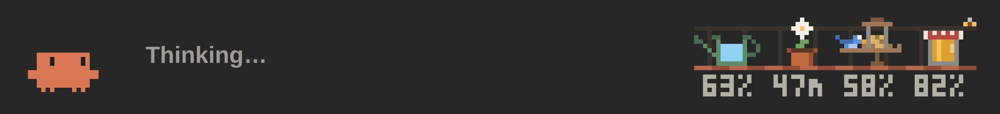
</p>

<p align="center">
  <b>A cozy pixel-art band above the prompt in Claude Code.</b><br>
  Clawd acts out what Claude is doing, beside a little scene of your session's context, prompt cache, and usage limits.
</p>

<p align="center">
  
  
</p>

Cozy Clawd is a mod for Claude Code: a plugin whose code runs inside Claude Code and draws on its screen. It adds a band of pixel art above the prompt, in the Code tab of the Claude desktop app and in the terminal. On the left, Clawd acts out each step of a turn. On the right, four objects work as meters of your session: the context left, the minutes left on the prompt cache, and what's left of your five-hour and weekly usage limits.

Cozy Clawd is an unofficial fan project. It isn't affiliated with or endorsed by Anthropic. Claude and Claude Code are trademarks of Anthropic, and Clawd is Anthropic's character; the MIT License covers this project's code, not Anthropic's marks.

## Install

Cozy Clawd needs the following:

- Claude Code 2.1.287 or later, where mods are on by default.
- The Code tab of the Claude desktop app, or a terminal. For the scenes' true colors, use a terminal with 24-bit color (truecolor), such as Windows Terminal or iTerm2; other terminals show approximate colors.

> **Note:** A mod is code that runs inside Claude Code with your permissions. For what Cozy Clawd reads, keeps, and runs, see [What the mod does on your machine](#what-the-mod-does-on-your-machine). To list what it hooks and calls, clone the repository and run `claude plugin validate .` from its root. For more information, see [Decide whether to trust a mod](https://code.claude.com/docs/en/plugins/mods/overview#decide-whether-to-trust-a-mod).

Installing takes two steps: add `orihuelaconde`, the plugin marketplace that lists OrihuelaConde's plugins, and then install the `cozy-clawd` plugin from it. You install the mod once for your user account: the terminal and the desktop app on one computer share installed plugins, so the band appears in both. Follow the steps for where you use Claude Code.

### Install from a terminal

To install the mod, run the following commands in a terminal, such as PowerShell on Windows or Terminal on macOS:

```bash
claude plugin marketplace add OrihuelaConde/claude-plugins
```

```bash
claude plugin install cozy-clawd@orihuelaconde
```

The first command prints `Successfully added marketplace: orihuelaconde`, and the second prints `Successfully installed plugin: cozy-clawd@orihuelaconde (scope: user)`. The band appears in the next session you start. To load the mod in a session that's already open, run `/reload-plugins` in it.

To install from inside a Claude Code session instead, run `/plugin install cozy-clawd --marketplace OrihuelaConde/claude-plugins`, press **y** to add the marketplace, and then select **Install for you (user scope)**.

If the install fails with `Host key verification failed`, see [The install fails with "Host key verification failed"](#the-install-fails-with-host-key-verification-failed).

### Install from the desktop app

In the Claude desktop app, you add the marketplace and install the mod from the **Plugins** page. To install the mod, do the following:

1. Open **Customize** > **Plugins**.
2. Select **Add** > **Add marketplace**, and then choose to add it from a repository.
3. In **URL**, enter `OrihuelaConde/claude-plugins`, and then select **Sync**.
4. On the **Discover** tab, search for `cozy`. Next to **Cozy clawd**, open the arrow beside **Add**, and then select the option that installs to `~/.claude/`, which makes the mod available in all your projects.
5. Start a new session in the Code tab, or send `/reload-plugins` in the session that's open. The band appears above the prompt.

### Update or uninstall the mod

By default, Claude Code doesn't update the mod. To update it, run the following command:

```bash
claude plugin update cozy-clawd@orihuelaconde
```

Then start a new session, or run `/reload-plugins` in a session that's already open.

To install updates automatically, run `/plugin` in a terminal session, go to the **Marketplaces** tab, select `orihuelaconde`, and then select **Enable auto-update**.

To turn the mod off and keep it installed, run `claude plugin disable cozy-clawd@orihuelaconde`. To uninstall it, run `claude plugin uninstall cozy-clawd@orihuelaconde`.

## What Clawd does

Each step of a turn has its own scene, and each family of tools has its own prop. Beside Clawd, the band says what Claude is doing, in the tool's own words when it knows the tool, such as "Reading a file…" or "Searching the code…".

<table>
  <tr>
    <td align="center">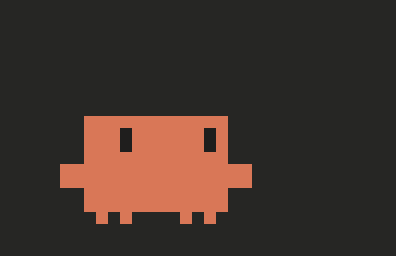<br><b>Thinking</b><br>Thought dots light a bulb</td>
    <td align="center"><br><b>Working on the answer</b><br>Clawd stacks blocks</td>
    <td align="center"><br><b>Writing the answer</b><br>Lines of text appear</td>
  </tr>
  <tr>
    <td align="center">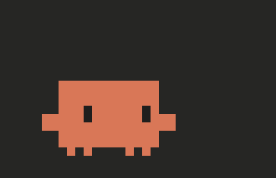<br><b>Reading files</b><br>A magnifier sweeps a page</td>
    <td align="center"><br><b>Editing files</b><br>A pencil writes</td>
    <td align="center">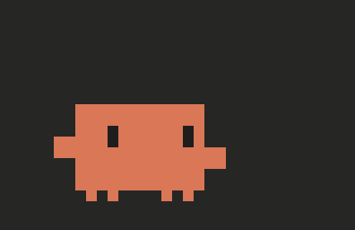<br><b>Running a command</b><br>Code rains on a monitor</td>
  </tr>
  <tr>
    <td align="center">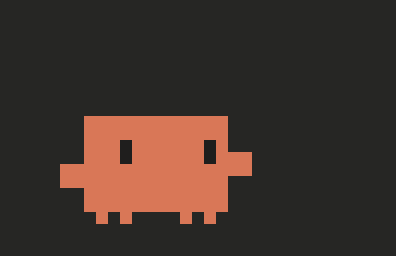<br><b>Browsing the web</b><br>A desk globe turns</td>
    <td align="center">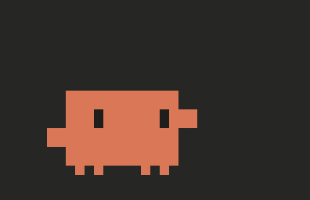<br><b>Launching a subagent</b><br>A small Clawd runs off</td>
    <td align="center">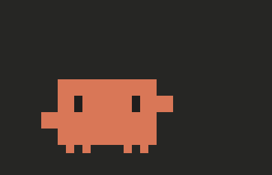<br><b>Any other tool</b><br>Clawd hammers away</td>
  </tr>
  <tr>
    <td align="center"><br><b>Compacting</b><br>Sheets pressed into a block</td>
    <td align="center">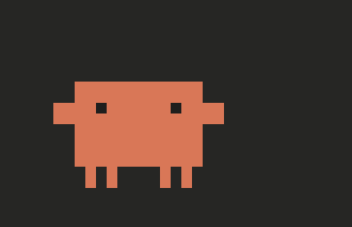<br><b>Compacted</b><br>A hop for joy</td>
    <td align="center">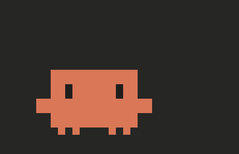<br><b>Waiting</b><br>Rest and pastimes</td>
  </tr>
  <tr>
    <td align="center">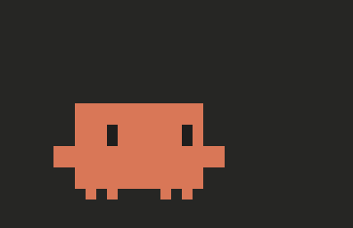<br><b>Cache running out</b><br>A drop of sweat</td>
    <td align="center">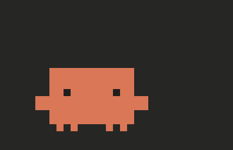<br><b>Cache almost out</b><br>A yawn</td>
    <td align="center">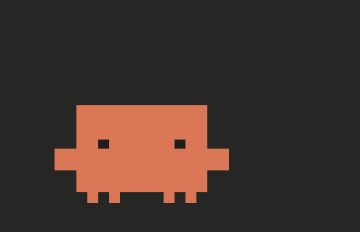<br><b>Cache expired</b><br>Asleep</td>
  </tr>
</table>

Between turns, Clawd rests, breathing slowly, blinking, and glancing around. For 9 seconds of every 39, it takes up a pastime picked at random: looking around, whistling, juggling, playing with a yo-yo, blowing soap bubbles, reading, dancing, or following a ladybug. While Claude waits for your approval or your answer, Clawd goes through its pastimes one after another, in random order, with a short rest between them.

When 10 minutes or less are left on an hour's prompt cache, Clawd frets with a drop of sweat. With 2 minutes or less, it yawns. A five-minute cache gets the same shares of its life: 50 and 10 seconds. Once the cache expires, Clawd falls asleep.

## Read the meters

The right side of the band shows four meters of your session, each an object with its number underneath in a pixel font. From left to right, they show the following:

1. The context window left, as a percentage.
2. The minutes left on the prompt cache, counted down from Claude's last answer.
3. What's left of your five-hour usage limit.
4. What's left of your weekly usage limit.

The cache meter counts down the length Claude Code keeps the cache for: an hour when you sign in with a Claude subscription, and five minutes with an API key or once you use up a usage limit. With an API key, Claude Code reports no usage limits, so the two usage-limit meters show `--`. For more information, see [What the meters measure](docs/scenes.md#what-the-meters-measure).

Each scene draws the meters as objects of its own. The images in this README show the `balcony` scene, which the band shows until you choose another: a watering can, a daisy in a pot, a bird feeder, and a jar of honey. For all eight, see [Choose a scene](#choose-a-scene).

When 25% or less of the context is left, a **Compact** button appears next to the scene. It asks you to confirm, and then compacts the conversation. While Claude compacts, the context meter fills up again: on the balcony, it rains into the watering can.

<p align="center">
  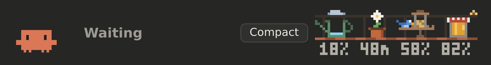
</p>

## Customize the band

The `/cozy-clawd` panel holds the mod's settings. A change applies at once, and later sessions start with it.

| Setting | Choices | Default | Details |
| --- | --- | --- | --- |
| Scene | Eight scenes | `balcony` | [Scenes](docs/scenes.md) |
| Size, in a terminal only | **Small** or **Large** | **Small** | [The band in a terminal](docs/terminal.md) |
| Language | Ten languages, or **Automatic** | **Automatic** | [Languages](docs/languages.md) |

### Choose a scene

To choose a scene, open the `/cozy-clawd` panel and select **Use** under the scene you want. In a terminal, the panel has a **Scene** picker instead. You can also switch the scene from the prompt with the following command:

```text
/cozy-clawd-scene SCENE_NAME
```

Replace `SCENE_NAME` with the name of a scene, such as `mate`. To see the current scene and the names available, run `/cozy-clawd-scene` with no name.

<table>
  <tr>
    <td align="center"><a href="docs/scenes.md#balcony">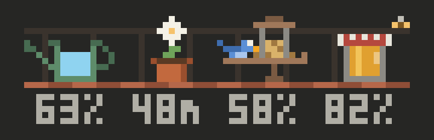</a><br><b>Balcony</b> <code>balcony</code> (default)</td>
    <td align="center"><a href="docs/scenes.md#mate">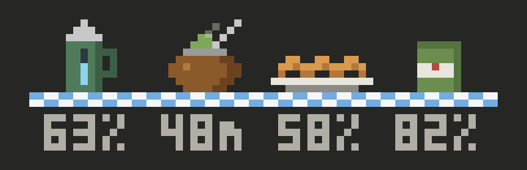</a><br><b>Mate</b> <code>mate</code></td>
  </tr>
  <tr>
    <td align="center"><a href="docs/scenes.md#teatime">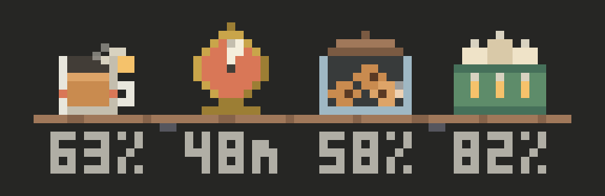</a><br><b>Teatime</b> <code>teatime</code></td>
    <td align="center"><a href="docs/scenes.md#night-window">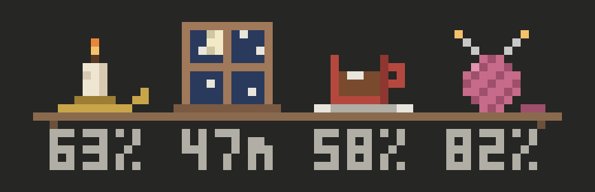</a><br><b>Night window</b> <code>window</code></td>
  </tr>
  <tr>
    <td align="center"><a href="docs/scenes.md#adventure">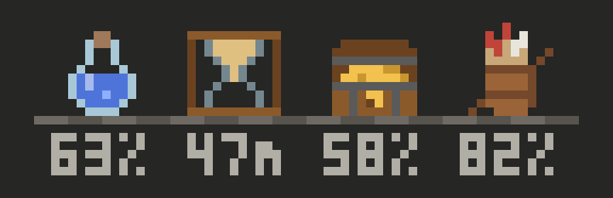</a><br><b>Adventure</b> <code>adventure</code></td>
    <td align="center"><a href="docs/scenes.md#gamer">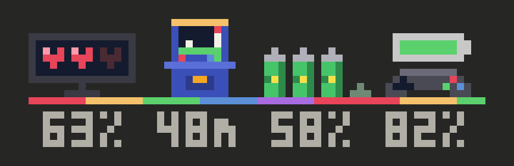</a><br><b>Gamer</b> <code>gamer</code></td>
  </tr>
  <tr>
    <td align="center"><a href="docs/scenes.md#cyberpunk">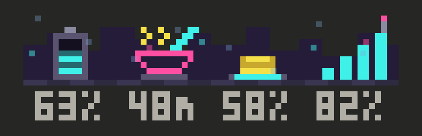</a><br><b>Cyberpunk</b> <code>cyberpunk</code></td>
    <td align="center"><a href="docs/scenes.md#steampunk">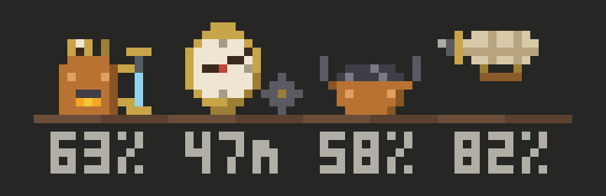</a><br><b>Steampunk</b> <code>steampunk</code></td>
  </tr>
</table>

For what each object shows, see [Scenes](docs/scenes.md).

## The band in a terminal

A terminal can't show the images the desktop app draws, so there the mod paints each scene in block characters and animates it frame by frame. The scenes, the cache's countdown, and the **Compact** button work as they do in the desktop app.

In a terminal, the band comes in two sizes. The small size, the default, has drawings of its own and takes 5 rows and at least 75 columns. The large size shows the desktop app's drawings and takes 9 rows and at least 109 columns. To change the size, use the **Size** picker in the `/cozy-clawd` panel. In the following image, the small size is above and the large size is below:

<p align="center">
  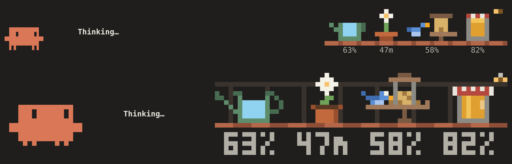
</p>

For what each size shows, how the band fits a narrow terminal, and how to get true colors in Windows Terminal or tmux, see [The band in a terminal](docs/terminal.md).

## Troubleshoot

### The install fails with "Host key verification failed"

Until October 6, 2026, the `orihuelaconde` marketplace listed the mod in a form that Claude Code on Windows clones over SSH, so the install failed for anyone without an SSH key for GitHub, with an error that ends in `Host key verification failed`. Since then, the marketplace lists the mod by its HTTPS address. If you added the marketplace before that date, refresh its listing, and then install the mod again. To do it in a terminal, run the following commands:

```bash
claude plugin marketplace update orihuelaconde
```

```bash
claude plugin install cozy-clawd@orihuelaconde
```

In the desktop app, refresh the marketplace from **Customize** > **Plugins** > **Add** > **Manage marketplaces**, and then install the mod again from the **Discover** tab.

### The band doesn't appear

Check the following:

- Claude Code is version 2.1.287 or later. To see the version, run `claude --version`.
- The session started after you installed the mod. To load the mod in a session that was already open, run `/reload-plugins` in it.
- The mod is turned on. To turn it back on, run `claude plugin enable cozy-clawd@orihuelaconde`.

### The colors look off in a terminal

With fewer than 24-bit colors, Claude Code approximates the scenes' colors, which shifts them. To fix it, see [Get true colors in Windows Terminal](docs/terminal.md#get-true-colors-in-windows-terminal) or [Get true colors in tmux](docs/terminal.md#get-true-colors-in-tmux).

### The band shows words instead of pictures

The terminal is too narrow, or too short, for the drawings. The small size needs 5 rows and at least 75 columns, and the large size needs 9 rows and at least 109 columns, plus a few columns while the **Compact** button shows. Enlarge the window, or choose the small size in the `/cozy-clawd` panel.

## What the mod does on your machine

Cozy Clawd is a mod: code that runs inside Claude Code with your permissions. It sends nothing off your machine: it makes no network requests, writes no files, sets no environment variables, and uses no credentials, such as an API key or a token. It keeps three choices in Claude Code's plugin store: the scene, the language, and the size. To find your language, it can run `reg.exe query` on Windows or `defaults read` on macOS. It watches each turn's events only to know what to draw, passes them on unchanged, and never answers a permission request for you.

<details>
<summary>Everything the mod reads, runs, keeps, and hooks</summary>

The address `http://www.w3.org/2000/svg` in the mod's code is the SVG namespace, which names the format of the band's drawings. Nothing connects to it.

### What it reads

The mod reads only what it needs to draw the band:

- **Each turn's progress.** From each response, the mod reads the kind of each piece (thinking, text, or a tool call), a tool's name, and whether the response finished. It doesn't read the text of the conversation.
- **The session's usage.** The context left and your usage limits, which the meters show, and whether the session is drawn in a terminal or in the desktop app.
- **Claude Code's settings.** Claude Code hands the mod all its settings, and the mod uses only `promptCacheTtl`, to time the cache meter. It also reads the **Language** and **Theme** rows of `/config`.
- **Environment variables.** The mod reads the following variables and no others:
  - `FORCE_PROMPT_CACHING_5M`, `CLAUDE_CODE_PROMPT_CACHE_TTL`, `ENABLE_PROMPT_CACHING_1H`, `ENABLE_PROMPT_CACHING_1H_BEDROCK`, `CLAUDE_CODE_USE_BEDROCK`, and `DISABLE_PROMPT_CACHING`, to know how long Claude Code keeps the prompt cache.
  - `LC_ALL`, `LC_MESSAGES`, and `LANG`, to find your language.
  - `OS` and `SystemRoot`, to know whether it runs on Windows and where Windows keeps `reg.exe`.
  - `COLORFGBG`, to know whether a terminal has a light background.

### What it runs

If neither the **Language** setting in `/config` nor the locale variables name a language the mod speaks, the mod asks the system for your language. It does so once a session, and again when the **Language** setting changes.

On Windows, the mod runs the following command, which answers with your preferred languages:

```text
%SystemRoot%\System32\reg.exe query "HKCU\Control Panel\International\User Profile" /v Languages
```

If that names no language, it runs the following command, which answers with your regional format:

```text
%SystemRoot%\System32\reg.exe query "HKCU\Control Panel\International" /v LocaleName
```

On other systems, the mod runs the following command, which macOS answers with your preferred languages. Where the program doesn't exist, the call fails at once.

```text
/usr/bin/defaults read -g AppleLanguages
```

Every argument is fixed text except the folder of `reg.exe`, which comes from the `SystemRoot` variable, or is `C:\Windows` when the variable isn't set. The mod runs each program by its full path and from the program's own folder, so that a program with the same name in your project can't run in its place. It passes nothing of yours to these commands, waits for each one 3 seconds at most, and reads only a language code from its output. These are the only programs the mod runs.

### What it keeps

The mod keeps three choices in Claude Code's plugin store, so later sessions start with them:

| Key | Value |
| --- | --- |
| `scene` | The scene you chose. |
| `language` | Your language choice in the `/cozy-clawd` panel. |
| `size` | The band's size in a terminal. |

While a session runs, the mod keeps what the band shows in the session's state, which ends with the session.

### What it hooks

The mod draws the band and the `/cozy-clawd` panel, and answers its own two commands. Every other hook passes its event on unchanged and returns Claude Code's result unchanged: the mod watches these events only to know what to draw, and decides nothing in them.

- **Permission requests** (`classic.PermissionRequest`). The mod never answers a request. From the result, it reads only whether a hook beneath it already decided, in which case Claude Code doesn't ask you. Otherwise, Clawd waits with a pastime while you decide.
- **Approvals** (`telemetry.log`, the records that Claude Code keeps for an operator's collector). Claude Code raises no other event when you approve a tool, so this is how Clawd knows to stop waiting. From each record, the mod reads only the event name and the `decision` and `source` fields, and acts only on a `tool_decision` record. It keeps nothing from these records and sends nothing.
- **Forms that ask you something** (`classic.Elicitation` and `classic.ElicitationResult`), so Clawd waits while you answer.
- **The start of a session** (`session.start` and `classic.SessionStart`), to load your choices, and to restart the cache meter after `/clear`, a resume, or a fork.
- **The steps of each turn and each tool call** (`turn.step`, `tool.call`, and `turn.complete`), to show what Claude is doing.
- **Compaction** (`session.compact`), to show it and refill the context meter.
- **Changes to the Language and Theme settings** (`config.set`), so the band follows a change once Claude Code applies it.
- **Focus in its own panel** (`ui.focus`). In the desktop app, the first click on a button in a panel that doesn't have the keyboard focus arrives only as a focus move, so the mod picks the scene or the language that the click landed on.

### What it changes

- It adds two commands, `/cozy-clawd` and `/cozy-clawd-scene`.
- The **Compact** button compacts the conversation only after you select **Yes**.

</details>

### Check it yourself

To list what the mod hooks and calls, clone the repository and run the following command from its root:

```bash
claude plugin validate .
```

The command ends with **Validation passed**.

## Contribute

To report a problem or suggest an idea, open an issue. The texts in languages other than English and Spanish are machine translations; to suggest a better one, open an issue or a pull request that edits the language's file in `hooks/languages/`. To work on the mod, see [Contribute to Cozy Clawd](CONTRIBUTING.md).

## License

Cozy Clawd is released under the [MIT License](LICENSE).
